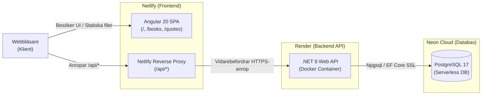
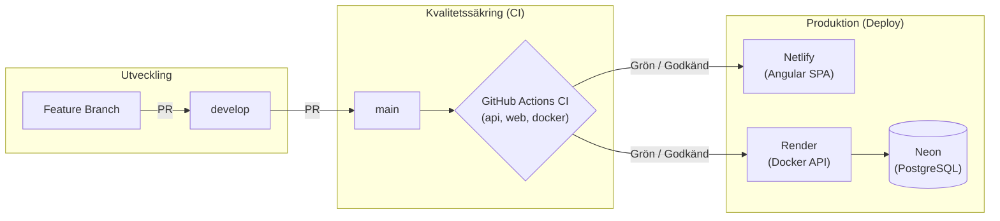
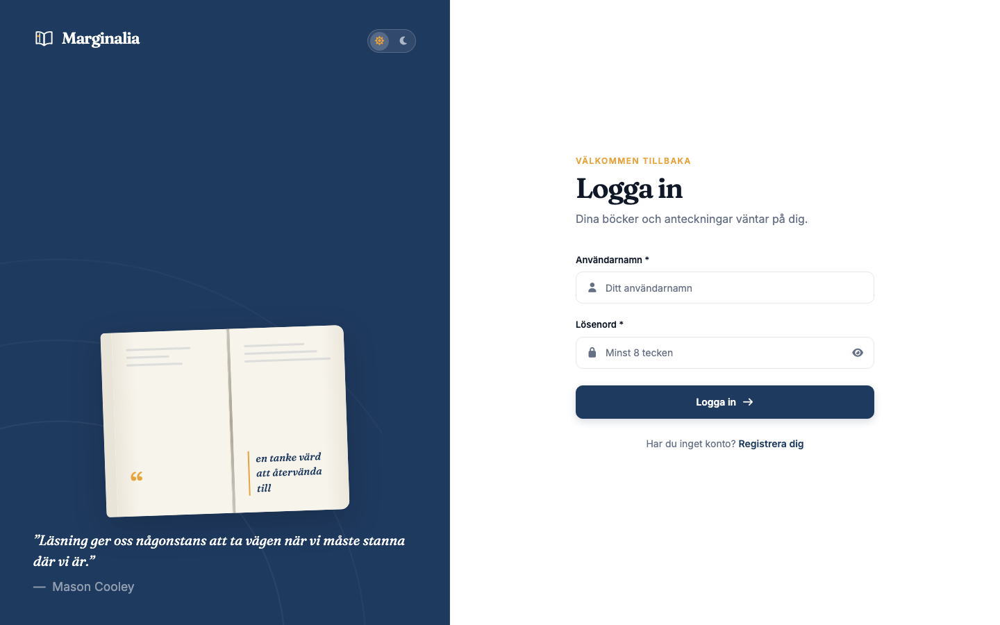
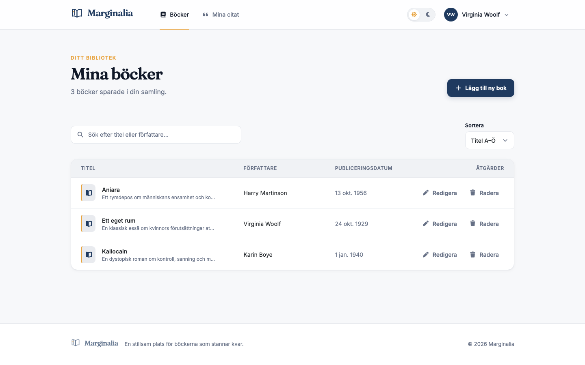
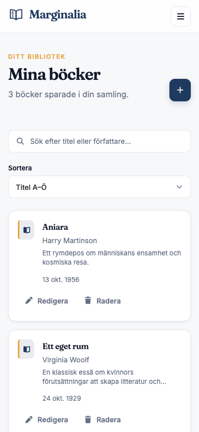
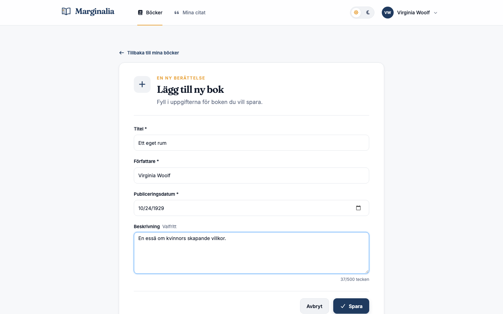
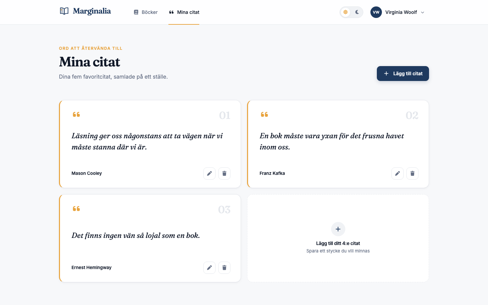
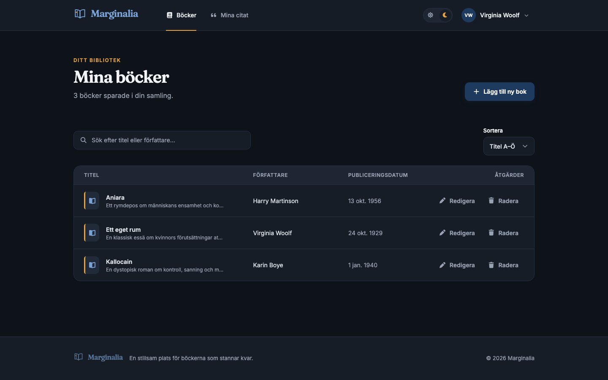

# Marginalia

[](https://github.com/amir0321/Marginalia/actions/workflows/ci.yml)

Ett personligt bibliotek för böcker och favoritcitat. Byggt som ett praktiktest: en responsiv CRUD-applikation med JWT-autentisering.

- **Live-applikation:** [https://cheerful-khapse-d0fc1d.netlify.app/](https://cheerful-khapse-d0fc1d.netlify.app/)
- **Källkod (GitHub):** [https://github.com/amir0321/Marginalia](https://github.com/amir0321/Marginalia)
- **Figma-design:** [Marginalia Design (Figma)](https://www.figma.com/design/Y9RPG9qktEoh21rKQhpBce/Untitled?node-id=1-3&m=dev&t=oRJIzL8nqgBreWKh-1&code-node-id=1-3)
- **GitHub Project (planering & board):** [https://github.com/users/amir0321/projects/8/views/1](https://github.com/users/amir0321/projects/8/views/1)

> [!NOTE]
> **Notis om uppstart:** Backend-API:t körs på Render Free Tier som automatiskt försätts i viloläge efter inaktivitet. Första anropet vid ett besök kan därför ta cirka 50–60 sekunder medan servern startar upp. Applikationen väcker automatiskt API:t i bakgrunden vid sidladdning via `GET /api/health`.

## Hur jag tänkte när jag byggde Marginalia (Mina egna val)

När jag fick det här arbetsprovet var grundkraven tydliga (inloggning, CRUD för böcker och en sida för 5 favoritcitat), men många tekniska vägval lämnades öppna. Här är vad jag själv prioriterade och varför:

1. **Lösa gratis-hostingens kallstarter i UI:t (`ApiWakeService`):**
   Eftersom mitt .NET-API körs på Render Free Tier somnar containern efter 15 minuters inaktivitet och tar nästan en minut att vakna. Jag tänkte på hur det upplevs för den som ska rätta kodtestet: om man öppnar sidan, försöker skapa ett konto och knappen bara tuggar i 50 sekunder tror man att appen är trasig. Därför byggde jag en liten bakgrundstjänst som pingar `/api/health` direkt när Angular laddas och visar en diskret notis om svaret dröjer mer än 2 sekunder.
2. **Netlify Reverse Proxy istället för CORS:**
   Istället för att öppna upp CORS i .NET-API:et och få extra `OPTIONS`-anrop före varje request valde jag att skicka `/api/*` genom Netlifys omvända proxy (`_redirects` i produktion och `proxy.conf.json` lokalt). För webbläsaren ser både Angular-appen och .NET-API:et ut att ligga på exakt samma domän.
3. **Angular Signals istället för tunga state-bibliotek:**
   För en applikation med den här omfattningen kändes NgRx som onödig överengineering. Genom att använda Angular 20:s inbyggda `signal()` och `computed()` för inloggningsstatus, tema (ljust/mörkt) och sök-/sorteringsfilter blev komponenterna betydligt kortare och enklare att skriva tester för.
4. **Svara `404 Not Found` istället för `403 Forbidden` på andras böcker:**
   Jag valde att filtrera alla databasfrågor direkt på `UserId` från användarens JWT-token. Om någon försöker hämta eller ta bort ett bok-ID som tillhör en annan användare svarar API:et `404` istället för `403`, så att man inte kan gissa vilka ID:n som finns i databasen (skydd mot IDOR).
5. **Hur jag använde AI under arbetet:**
   Jag använde AI som bollplank för att granska kantfall i testerna, felsöka Docker/GitHub Actions-pipelinen och strukturera dokumentationen – medan jag själv tog alla beslut kring arkitekturen, datamodellen i EF Core och gränssnittet i Figma.

## Funktioner
- Registrera konto och logga in (JWT)
- Skapa, visa, redigera och radera böcker
- "Mina citat": upp till fem favoritcitat per användare
- Responsiv design (desktop, surfplatta, mobil) med Bootstrap och Font Awesome
- Ljust och mörkt läge *(extrauppgift)*

## Teknik

| Del | Teknik & Versioner | Värd / Drift |
|---|---|---|
| **Frontend** | Angular 20 (`@angular/core` ^20.3.0), Bootstrap 5.3 (`bootstrap` 5.3, `@ng-bootstrap/ng-bootstrap` ^19.0.1), Font Awesome Free (`@fortawesome/fontawesome-free` ^7.3.1), Typsnitt (`@fontsource/fraunces` ^5.3.0, `@fontsource/inter` ^5.3.0), RxJS ~7.8.0, TypeScript ~5.9.2 | Netlify (Statisk SPA med omvänd proxy) |
| **Backend API** | .NET 9 (`net9.0`, ASP.NET Core Web API), EF Core 9 (`Microsoft.EntityFrameworkCore.Design` 9.0.1, `Npgsql.EntityFrameworkCore.PostgreSQL` 9.*), JWT Bearer (`Microsoft.AspNetCore.Authentication.JwtBearer` 9.0.1), Scalar OpenAPI (`Scalar.AspNetCore` 2.18.0) | Render (Containeriserad Linux Docker Web Service) |
| **Databas** | PostgreSQL 17 (Docker lokalt) / Neon Serverless PostgreSQL (Produktion) | Neon (PostgreSQL via SSL Mode=Require) |
| **Test & Kvalitet** | xUnit, Moq, Karma, Jasmine, Playwright (^1.64.1) | GitHub Actions CI |

## Projektstruktur

```text
.
├── api/                       # .NET 9 Web API
│   ├── Marginalia.Api/        # Controllers, Data, DTOs, Modeller, Services
│   ├── Marginalia.Api.Tests/  # xUnit-tester för controllers, auth och affärsregler
│   └── README.md              # Backend-dokumentation
├── web/                       # Angular 20 SPA (Standalone components, Signals)
│   ├── src/app/
│   │   ├── core/              # AuthService, guards, interceptors, tema, toast
│   │   ├── features/          # auth (login/register), books (CRUD), quotes (CRUD), not-found
│   │   ├── layout/            # App-shell, navigation, sidfot
│   │   └── shared/            # Återanvändbara komponenter (modal, logo, badges)
│   ├── e2e/                   # Playwright E2E-tester
│   └── README.md              # Frontend-dokumentation
├── docs/                      # Designhandbok, specifikationer och skärmdumpar
│   ├── design/                # Detaljerade specifikationer (tokens, typografi, komponenter, skärmar)
│   ├── design-system.md       # Huvuddokument för designsystemet
│   └── screenshots/           # Applikationsskärmdumpar
├── .github/workflows/ci.yml   # Kontinuerlig integration (CI)
├── docker-compose.yml         # Lokal PostgreSQL 17-databas
└── netlify.toml               # Netlify proxy- och byggkonfiguration
```

## Köra lokalt

### Förutsättningar
- Docker Desktop
- .NET 9 SDK
- Node.js ≥ 20 och npm

### 1. Starta databasen (PostgreSQL via Docker)

```bash
docker compose up -d
```

Databasen `marginalia` startar på port 5432 (användare `postgres`, lösenord `dev`).

### 2. Konfigurera API:t med user-secrets

Navigera till API-projektet och kör:

```bash
cd api/Marginalia.Api

dotnet user-secrets init

dotnet user-secrets set "ConnectionStrings:Default" \
  "Host=localhost;Port=5432;Database=marginalia;Username=postgres;Password=dev"

dotnet user-secrets set "Jwt:Key" "ERSÄTT-MED-MINST-32-TECKEN-LÅNG-NYCKEL"
dotnet user-secrets set "Jwt:Issuer" "marginalia"
dotnet user-secrets set "Jwt:Audience" "marginalia-web"
dotnet user-secrets set "Jwt:ExpiresMinutes" "60"
```

> **OBS:** `Jwt:Key` måste vara minst 32 tecken. Generera t.ex. med:
> `openssl rand -base64 32`

### 3. Bygg och starta API:t

```bash
# Fortfarande i api/Marginalia.Api
dotnet build
dotnet run
```

API:t startar på **http://localhost:5080**.  
Hälsokontroll: `GET http://localhost:5080/api/health` → `{"status":"ok"}`

EF Core kör migrationerna automatiskt vid uppstart.

### 4. Installera och starta frontend

```bash
cd ../../web
npm install
npm start
```

Frontend startar på **http://localhost:4200**.  
Alla `/api/*`-anrop proxyas automatiskt till `http://localhost:5080`.

### URL:er lokalt

| Tjänst | URL |
|---|---|
| Frontend (Angular) | http://localhost:4200 |
| Hälsokontroll (via Angular-proxy) | http://localhost:4200/api/health |
| API (direkt) | http://localhost:5080/api |
| Hälsokontroll (direkt) | http://localhost:5080/api/health |
| API-dokumentation (Scalar) | http://localhost:5080/scalar |

## API-endpoints

Samtliga anrop (förutom hälsokontroll och registrering/inloggning) kräver `Authorization: Bearer <token>` och hanterar data strikt per inloggad användare:

| Metod | Endpoint | Beskrivning | Auth | Statuskoder |
|---|---|---|---|---|
| `GET` | `/api/health` | Hälsokontroll för hosting och uppväckning | Nej | `200` |
| `POST` | `/api/auth/register` | Skapar ett nytt användarkonto | Nej | `201`, `400`, `409` |
| `POST` | `/api/auth/login` | Loggar in och returnerar en 60-minuters JWT | Nej | `200`, `400`, `401` |
| `GET` | `/api/books` | Hämtar användarens böcker (sorterade på titel) | Ja | `200`, `401` |
| `GET` | `/api/books/{id}` | Hämtar en specifik bok för användaren | Ja | `200`, `401`, `404` |
| `POST` | `/api/books` | Skapar en ny bok (titel, författare, datum, beskrivning) | Ja | `201`, `400`, `401` |
| `PUT` | `/api/books/{id}` | Uppdaterar en befintlig bok | Ja | `200`, `400`, `401`, `404` |
| `DELETE` | `/api/books/{id}` | Raderar en bok permanent | Ja | `204`, `401`, `404` |
| `GET` | `/api/quotes` | Hämtar användarens citat (äldst först) | Ja | `200`, `401` |
| `POST` | `/api/quotes` | Skapar ett citat (max 5 citat per användare) | Ja | `201`, `400`, `401`, `409` |
| `PUT` | `/api/quotes/{id}` | Uppdaterar ett befintligt citat | Ja | `200`, `400`, `401`, `404` |
| `DELETE` | `/api/quotes/{id}` | Raderar ett citat permanent | Ja | `204`, `401`, `404` |

## Köra tester och kvalitetssäkring

Samtliga delar av projektet har heltäckande enhetstester och kan köras lokalt med följande kommandon:

### 1. Kör alla API-tester
Kör alla .NET 9-enhetstester och integrationstester:
```bash
cd api && dotnet test
```

### 2. Kör alla frontend-enhetstester
Kör alla Angular-tester i headless-läge (Karma + ChromeHeadless):
```bash
cd web && npx ng test --watch=false --browsers=ChromeHeadless
```

### 3. Testa CI-kommandona i Docker
Verifiera att API:ets Dockerfile bygger felfritt:
```bash
docker build -t marginalia-api:ci ./api/Marginalia.Api
```

### 4. Bygg frontend för produktion
Verifiera att produktionspaketet byggs utan fel eller budgetvarningar:
```bash
cd web && npm run build
```

## Arkitektur och hosting

Marginalia använder en same-origin-arkitektur baserad på omvänd proxy (reverse proxy), vilket eliminerar behovet av CORS (Cross-Origin Resource Sharing) helt och hållet:



- **Lokalt (utveckling):** Angular Dev Server proxyar alla anrop mot `/api/*` till backend-servern på `http://localhost:5080` via `web/proxy.conf.json`.
- **Produktion:** Frontend hostas som en statisk SPA på Netlify, medan API:t körs som en containeriserad Docker-webbtjänst på Render. Netlify dirigerar om alla `/api/*`-anrop till Render via regeln i `web/public/_redirects`, innan SPA-fallbacksregeln fångar upp resterande rutter.
- **Varför ingen CORS:** Eftersom webbläsaren endast kommunicerar med samma ursprung (same-origin) både lokalt (`http://localhost:4200`) och i produktion (Netlify-domänen) behövs inga CORS-headers (`AddCors`/`UseCors`). Detta minskar attackytan och eliminerar preflight-anrop (`OPTIONS`).
- **Säker hemlighetshantering:** Känsliga konfigurationsvärden (`ConnectionStrings:Default` och `Jwt:Key`) checkas aldrig in i källkod eller konfigurationsfiler. Lokalt lagras de utanför versionshanteringen med `dotnet user-secrets`. I produktion (Render) injiceras de som miljövariabler (`ConnectionStrings__Default`, `Jwt__Key`, `Jwt__Issuer`, `Jwt__Audience`, `Jwt__ExpiresMinutes`). En mall finns i `.env.example`.
- **Uppväckning av fria instanser:** Gratisinstanser på Render går i viloläge efter ~15 minuters inaktivitet och behöver upp till en minut för att starta. Frontend skickar en hälsokontroll (`GET /api/health`) vid appstart för att väcka API:t i bakgrunden och informerar användaren med en toast först om svaret dröjer mer än 2 sekunder.

## Hur autentisering fungerar

Marginalia använder JSON Web Tokens (JWT) för tillståndslös (stateless) autentisering mellan frontend och backend:

1. **Inloggning & registrering:**
   - Vid registrering (`POST /api/auth/register`) skapas användarkontot och lösenordet hashas med ASP.NET Core `PasswordHasher<User>`.
   - Vid inloggning (`POST /api/auth/login`) valideras uppgifterna. Om autentiseringen lyckas returnerar API:t en signerad JWT-token med 60 minuters giltighetstid.
2. **Lagring i webbläsaren:**
   - Frontend sparar token i `localStorage` under nyckeln `marginalia.token`.
   - `AuthService` läser token vid appstart och härleder reaktivt inloggningsstatus (`isLoggedIn`) och användarnamn (`username`) från JWT-payloaden (`unique_name`, `exp`) med Angular-signaler.
3. **Bearer-interceptor (`authInterceptor`):**
   - Samtliga anrop mot `/api/*` (exklusive `/api/auth/login` och `/api/auth/register`) får automatiskt headern `Authorization: Bearer <token>` bifogad via en funktionell Angular HTTP-interceptor.
4. **Route guards:**
   - `authGuard` skyddar privata sidor (`/books`, `/books/new`, `/books/:id/edit`, `/quotes`). Oinloggade besökare dirigeras till `/login`.
   - `guestGuard` förhindrar inloggade användare från att besöka `/login` och `/register` och skickar dem vidare till `/books`.
5. **Utloggning & hantering av 401 Unauthorized:**
   - När en användare klickar på "Logga ut" rensas `marginalia.token` från `localStorage` och användaren navigeras till `/login`.
   - Om en token har löpt ut eller blivit ogiltig och ett skyddat API-anrop svarar med `401 Unauthorized`, fångar `authInterceptor` felet automatiskt, rensar sessionen, omdirigerar till `/login` och visar en informativ varningstoast: *"Din session har gått ut. Logga in igen för att fortsätta."*.
   - Felaktiga inloggningsförsök (`401` från `/api/auth/login`) fångas lokalt i formuläret och visar ett felmeddelande utan att trigga sessionsutloggning eller global toast.

### Säkerhetsavvägning: `localStorage` kontra `HttpOnly`-cookie (XSS vs CSRF)

Valet att lagra JWT i `localStorage` gjordes medvetet utifrån applikationens arkitektur och kraven i kodtestet:

- **Fördelar med `localStorage`:**
  - **Skydd mot CSRF (Cross-Site Request Forgery):** Webbläsaren bifogar inte `localStorage`-data automatiskt i HTTP-anrop till skillnad från kakor. Det gör att applikationen är immun mot klassiska CSRF-attacker utan att behöva hantera Anti-Forgery-tokens eller SameSite-undantag.
  - **Enkel och ren SPA-integration:** Frontend har full kontroll över när och hur token skickas via `Authorization`-headern, vilket passar utmärkt med reverse-proxy-arkitekturen och stateless API-design.
- **Avvägning och sårbarheter (XSS):**
  - Den främsta risken med `localStorage` är att token kan läsas av skadlig JavaScript vid en eventuell XSS-sårbarhet (Cross-Site Scripting).
  - En `HttpOnly`-kaka skyddar mot att klientskript kan läsa token direkt, men kräver i stället strikt CSRF-hantering och komplicerar proxykonfiguration.
- **Hur vi säkrar `localStorage` mot XSS:**
  - Angulars inbyggda strikta mall-sanering används konsekvent: inga opålitliga `innerHTML`, `bypassSecurityTrust*` eller `document.write`.
  - All användardata interpoleras säkert i HTML.
  - Backend validerar och sanerar all indata strikt.
  - Kort livslängd på JWT (60 minuter) och ingen refresh token minskar fönstret för ett eventuellt kapat token.

## CI/CD-pipeline (GitHub Actions)

Projektet använder en automatiserad kontinuerlig integrationspipeline via GitHub Actions ([`.github/workflows/ci.yml`](.github/workflows/ci.yml)).

- **Triggers:** Körs automatiskt vid varje `push` samt `pull_request` mot brancherna `main` och `develop`.
- **Tre parallella jobb:**
  1. **`api` (.NET 9):**
     - Sätter upp .NET 9 SDK
     - Kör `dotnet restore`
     - Bygger solutionen: `dotnet build --configuration Release --no-restore`
     - Kör samtliga tester: `dotnet test --configuration Release --no-build`
  2. **`web` (Angular 20):**
     - Sätter upp Node.js 20 med npm-cache (`package-lock.json`)
     - Installerar rena beroenden: `npm ci`
     - Bygger produktionspaketet: `npm run build`
     - Kör samtliga enhetstester: `npx ng test --watch=false --browsers=ChromeHeadless`
  3. **`docker` (Container Build):**
     - Verifierar att API-containern bygger felfritt: `docker build -t marginalia-api:ci ./api/Marginalia.Api`

### Deploy-process och automatisk publicering

Marginalia tillämpar automatisk driftsättning vid uppdatering av `main`. För att garantera att endast stabil och felfri kod når produktionsmiljön krävs att alla automatiserade kvalitetskontroller i CI godkänts innan ändringar får slås samman med produktionsgrenen.

#### Arbetsflöde för publicering
1. Utveckling sker i isolerade feature-grenar (`feat/*`, `fix/*`, `chore/*`, `docs/*`).
2. Pull Request öppnas mot integrationsgrenen `develop`.
3. GitHub Actions körs automatiskt och validerar API, web och containerbygge.
4. Efter godkänd CI mergas ändringen till `develop`.
5. Inför release öppnas en Pull Request från `develop` till `main`.
6. Först när alla CI-kontroller är **helt gröna** mergas ändringen in i `main`.
7. **Automatisk publicering triggas:**
   - **Netlify:** Bygger och publicerar Angular-frontend (`web`) från `main` till globala CDN-noder.
   - **Render:** Med inställningen *Auto-Deploy: After CI Checks Pass* bygger och driftsätter Render automatiskt den uppdaterade Docker-containern för .NET-API:t (`api/Marginalia.Api`).



#### Övervakning och deploy-status
- **GitHub:** Grön bock bredvid den senaste commiten på `main` bekräftar att CI-pipelinen har passerat.
- **Netlify:** Under fliken **Deploys** i Netlify Dashboard syns byggstatus i realtid ("Building" → "Published").
- **Render:** Under fliken **Events** och **Logs** i Render Dashboard visas byggloggen och containerstart fram till status "Live".

#### Återställning (Rollback)
Om en oväntad regression eller ett driftfel skulle uppstå i produktion kan miljön återställas omedelbart utan att ny kod behöver checkas in:
- **Netlify (Frontend):** Gå till **Deploys**, klicka på en tidigare fungerande deploy i historiken och välj **Publish deploy**. Netlify växlar omedelbart CDN-trafiken till den stabila versionen.
- **Render (API):** Gå till **Events** (eller **Deploys**), klicka på menyikonen (`...`) vid den senaste stabila deployen och välj **Rollback to this deploy**.

#### Hantering av viloläge (Render Free Tier)
Efter cirka 15 minuters inaktivitet går Render Free-instansen i viloläge för att spara resurser.
- Vid nästa inkommande anrop tar uppstarten cirka 50–60 sekunder.
- Applikationens frontend hanterar detta automatiskt via `ApiWakeService`: vid appstart skickas en bakgrundsförfrågan till `/api/health`. Om API:t sover visas en diskret informationstoast för användaren medan anropet repeteras tills servern är vaken och redo.

## Versionshantering och arbetssätt

- **Branch-strategi:**
  - `main`: Alltid stabil och produktionsredo version (speglar driftmiljön).
  - `develop`: Huvudsaklig integrationsbranch där färdiga funktioner sammanförs.
  - Feature-brancher skapas från `develop` eller aktuell bas och namnges enligt:
    - `feat/<issue>-<kort-namn>` för nya funktioner (t.ex. `feat/20-33-search-sort-and-ci`)
    - `fix/<issue>-<kort-namn>` för buggrättningar
    - `docs/<issue>-<kort-namn>` för dokumentation
    - `chore/<issue>-<kort-namn>` för underhåll, byggskript och beroenden
- **Commit-meddelanden:**
  - Skrivs på engelska i imperativ form med referens till issue:
    - `feat: add book search and secondary sorting (#20)`
    - `ci: configure GitHub Actions workflow for api, web and docker (#33)`
    - `docs: update readme with testing and version control guide`
- **Pull Requests:**
  - PR öppnas mot målgrenen (`develop` eller `main`).
  - PR-mallen ska innehålla: vad som har ändrats, varför ändringen gjordes, hur ändringen testats, samt `Closes #<issue>` för att koppla och stänga ärendet automatiskt vid merge.
  - Alla jobb i CI-pipelinen (`api`, `web`, `docker`) måste passera grönt innan en PR får mergas.
- **Projektstyrning:**
  - Uppgifterna hanteras på GitHub Project-tavlan med epics, stories och tydliga acceptanskriterier.

## Antaganden och beslut

Uppgiften lämnar några saker öppna. Så här tolkade jag dem:

| Fråga | Beslut | Motivering |
|---|---|---|
| Ska data vara per användare? | Ja, både böcker och citat | "Mina böcker" och "Mina citat" är personliga. API:t filtrerar på användar-id från token. Någon annans post ger 404. |
| Är "5 citat" ett tak eller exakt 5? | Tak: 0–5 citat | Kravet att lägga till och ta bort kräver att antalet kan variera. Gränsen kontrolleras både i API och UI. |
| Autentisering | JWT, giltig i 60 min, ingen refresh token | Räcker för uppgiften. Vid utgången session loggas användaren ut. |
| Var lagras token? | `localStorage` | Enkelt för en SPA. Avvägning: läsbar vid XSS, men Angular escapar innehåll. Cookie hade krävt CSRF-skydd. |
| Registrering | Användarnamn + lösenord (min 8 tecken). Unikt användarnamn. | Matchar testets krav. Samma regler i frontend och backend. |
| Lösenordslagring | Hashas med ASP.NET Core `PasswordHasher` | Aldrig klartext. |
| Radering | Permanent, med bekräftelsedialog | Enklast, och dialogen minskar risken för misstag. |
| Hosting och databas | Se "Arkitektur och hosting" ovan | |

**Utanför omfattning:** lösenordsåterställning, e-post, roller, refresh tokens och
sidindelning.

## Skärmdumpar

Applikationens vyer är utformade efter designsystemet i [`docs/design-system.md`](docs/design-system.md) och anpassade för alla skärmstorlekar.

| Vy | Beskrivning | Skärmdump |
|---|---|---|
| **Inloggning & Registrering** | Split-screen för desktop (`≥992px`) med varumärkespanel, 3D-öppen bok och formulär med tillgängliga felmeddelanden. |  |
| **Mina böcker (Desktop 1440 px)** | Bibliotekstabell med realtidssökning, sortering (A–Ö, nyast först), snabböversikt och åtgärder. |  |
| **Mina böcker (Mobil 390 px)** | Responsiv mobilvy med adaptiva bokkort, fällbar hamburgermeny och touch-anpassade knappar. |  |
| **Bokformulär** | Lägg till/redigera böcker med live-teckenräknare (0/500 tecken) och strikt fältvalidering. |  |
| **Mina citat** | Gallerivy över upp till 5 favoritcitat med Fraunces-typografi, dekorativa amber-accenter och modalredigering. |  |
| **Mörkt läge** | Fullständigt mörkt tema som bevarar kontrast (WCAG AA), mjuka ytor och behaglig läsning i mörka miljöer. |  |

## Vad jag lärde mig / avvägningar

1. **Same-origin via reverse proxy framför CORS:** Genom att utnyttja Netlifys omvända proxy (`_redirects`) och Angulars lokala utvecklingsproxy (`proxy.conf.json`) slipper applikationen CORS-konfiguration helt och hållet. Det eliminerar onödiga `OPTIONS`-preflightanrop, förenklar API:et och stärker säkerheten.
2. **`localStorage` kontra `HttpOnly`-cookie:** Att lagra JWT i `localStorage` ger ett naturligt skydd mot CSRF-attacker (Cross-Site Request Forgery) utan behov av komplicerade anti-forgery-tokens eller cross-site cookie-undantag. Risken för XSS hanteras defensivt via Angulars strikta mall-sanering (inga opålitliga `innerHTML`), inga känsliga claims i JWT och en kort token-livslängd på 60 minuter.
3. **Signalbaserad reaktivitet i Angular 20:** Genom att uteslutande använda moderna Angular-signaler (`signal`, `computed`, `toSignal`) kunde applikationen hållas lätt och fri från tunga externa tillståndshanterare som NgRx. Session, färgtema och sökfilter uppdateras blixtsnabbt med optimal `OnPush` Change Detection.
4. **Eliminering av initialt layout-flimmer:** När Angular startar är `router.url` initialt `'/'` innan navigeringen till ruttens modul har slutförts. Genom att synkront läsa webbläsarens faktiska sökväg (`window.location.pathname`) vid appstart undveks ett fult layout-flimmer där applikationens toppmeny och sidfot tidigare blinkade till vid omladdning av login-sidan.
5. **UX vid kallstarter på gratis hosting:** Då Render Free Tier försätter instanser i viloläge efter inaktivitet implementerades en asynkron hälsoväckare (`ApiWakeService`). Den initierar ett bakgrundsanrop mot `/api/health` vid sidstart och visar en diskret informationstoast endast om API:t faktiskt sover och dröjer över 2 sekunder.
6. **Strikta API-kontrakt och defensiv felhantering:** Backend och frontend harmoniserades helt kring RFC 7807 `ProblemDetails` med enhetliga svenska felmeddelanden. Behörighetskontroller tillämpar principen att anrop mot en annan användares resurser konsekvent returnerar `404 Not Found` (aldrig `403`), vilket förhindrar att en angripare kan lista ut vilka ID:n som existerar i systemet (skydd mot IDOR).

